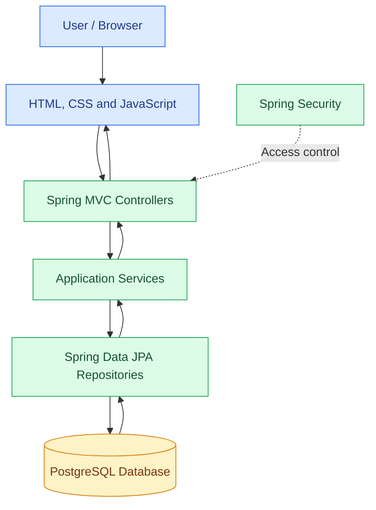

 <div align="center">

# درنگ | Derang

### ✨ Pause. Read. Reflect.

**A Persian-first blogging platform built with Java and Spring Boot.**

A full-stack blogging application designed to provide a right-to-left reading and writing experience, with blog management, categories, tags, user accounts, and comments.

[](https://www.java.com/)
[](https://spring.io/projects/spring-boot)
[](https://www.postgresql.org/)
[](https://maven.apache.org/)

[](https://developer.mozilla.org/en-US/docs/Web/HTML)
[](https://developer.mozilla.org/en-US/docs/Web/CSS)
[](https://developer.mozilla.org/en-US/docs/Web/JavaScript)
[](https://hibernate.org/)
[](https://spring.io/projects/spring-security)

[Features](#-features) · [Technology Stack](#-technology-stack) · [Getting Started](#-getting-started) · [Architecture](#-architecture) · [Security](#-security)

</div>

---

## 📖 Table of Contents

- [Overview](#-overview)
- [Features](#-features)
- [Technology Stack](#-technology-stack)
- [Repository Languages](#-repository-languages)
- [Architecture](#-architecture)
- [Project Structure](#-project-structure)
- [Getting Started](#-getting-started)
- [Configuration](#-configuration)
- [Database Design](#-database-design)
- [Application Routes](#-application-routes)
- [Security Considerations](#-security-considerations)
- [Running and Testing](#-running-and-testing)
- [Troubleshooting](#-troubleshooting)
- [Future Improvements](#-future-improvements)
- [Contributing](#-contributing)
- [License](#-license)

---

## 🌟 Overview

**Derang (درنگ)** is a blogging platform built with Java and the Spring ecosystem. Its main goal is to combine a structured backend with a simple web interface designed for Persian-language content.

The application brings together content management, taxonomy management, user-related functionality, and comment handling. Its interface uses Persian typography and a right-to-left layout to provide a more natural experience for Persian readers.

The project is also an opportunity to explore practical full-stack development concepts, including relational database design, object-relational mapping, server-side rendering, application security, and the separation of application responsibilities.

### 🎯 Project Goals

- Build a functional blogging platform using Java and Spring Boot.
- Organize application logic into maintainable components.
- Model relationships between users, blogs, comments, categories, and tags.
- Provide a Persian-first interface with right-to-left support.
- Practice database integration with Spring Data JPA and PostgreSQL.
- Explore authentication, authorization, and web application security.
- Create a foundation that can be extended with additional blogging features.

## ✨ Features

### 📝 Blog Management

- Manage blog content through administrative pages.
- Organize posts using categories and tags.
- Store content-related information such as titles, slugs, status, and timestamps where implemented.
- Track blog views using a view-counter field.
- Support a workflow that can be extended with additional publishing controls.

### 🗂️ Taxonomy Management

- Organize content into categories.
- Associate tags with content for more flexible organization.
- Manage taxonomy information through an administrative interface.
- Use slugs to support readable identifiers where routing is implemented.

### 💬 Comment System

- Associate comments with their corresponding blogs and users.
- Store comment text, ratings, and timestamps.
- Represent comment approval using an acceptance status.
- Keep comment-related logic separate from the main blog content.

### 👤 User Management

- Represent users as database entities.
- Associate user information with content and comments.
- Support user-related application operations.
- Integrate user access with the application's security configuration.

### 🎨 Persian-First Interface

- Right-to-left page layout using `dir="rtl"`.
- Persian typography using fonts such as Vazirmatn and Noto Naskh where configured.
- HTML, CSS, and JavaScript for the frontend.
- Theme-related interface support where implemented.

### ⚙️ Backend and Data Management

- Java-based application logic.
- Spring Boot for application configuration and startup.
- Spring Data JPA for database access.
- Hibernate for object-relational mapping.
- PostgreSQL for relational data storage.
- DTOs for transferring data between application layers where used.
- Spring Security for configuring application access.

---

## 🧰 Technology Stack

| Technology | Purpose |
|---|---|
| **Java 25** | Main programming language |
| **Spring Boot 4.0.0** | Application framework |
| **Spring Web / MVC** | HTTP request handling and web endpoints |
| **Spring Data JPA** | Repository and persistence abstractions |
| **Hibernate 7.1.8.Final** | Object-relational mapping |
| **PostgreSQL** | Relational database |
| **Spring Security** | Authentication and authorization configuration |
| **JJWT 0.12.5** | JSON Web Token functionality where integrated |
| **Thymeleaf** | Server-side HTML rendering where used |
| **HTML5** | Web page structure |
| **CSS3** | Layout, styling, and visual presentation |
| **JavaScript** | Client-side interactions |
| **Maven** | Dependency management and build automation |
| **Git and GitHub** | Version control and source hosting |

### 🟠 Backend

Java and Spring Boot provide the foundation for application logic, web request handling, persistence, and security configuration.

### 🟢 Database

PostgreSQL stores structured application data, while Spring Data JPA and Hibernate provide the persistence layer for working with database entities.

### 🔵 Frontend

HTML, CSS, and JavaScript create the user interface. Thymeleaf is used where server-rendered templates are part of the application.

### 🛡️ Security

Spring Security provides the foundation for controlling access to application resources. JJWT is included in the technology stack for token-related functionality where integrated.

---

## 📊 Repository Languages

Derang combines Java backend code with web technologies for its frontend.

GitHub automatically analyzes the languages in a repository and displays their relative proportions on the repository page.

<div align="center">

[](https://github.com/artecktor/blog-website-regular)
[](https://github.com/artecktor/blog-website-regular)

**[📈 View the repository's language percentages on GitHub](https://github.com/artecktor/blog-website-regular)**

</div>

> **Note:** The badges above display the repository's dominant language and the number of detected languages. They do not display each language's percentage individually. Open the repository page to see GitHub's language breakdown.

---

## 🏗️ Architecture

Derang follows a Java-based web application structure, separating web-facing functionality, application logic, persistence, and database entities where applicable.

### Request Flow



*This diagram illustrates the intended architectural responsibilities. It is a conceptual overview rather than a guarantee that every feature follows every layer identically.*

### Main Components

| Component | Responsibility |
|---|---|
| **Controllers** | Handle HTTP requests and determine the appropriate response. |
| **Services** | Contain application operations and coordinate business logic where implemented. |
| **Repositories** | Provide database access through Spring Data JPA. |
| **Entities** | Represent persistent domain objects and their relationships. |
| **DTOs** | Carry data between layers and support data conversion where used. |
| **Templates** | Render server-side HTML pages where Thymeleaf is used. |
| **Static resources** | Contain frontend stylesheets, scripts, and other static assets. |
| **Security configuration** | Defines authentication, authorization, and request access rules. |

---

## 📁 Project Structure

The following is a **conceptual guide** to the main types of files in a Spring Boot project. Refer to the repository itself for the exact package names and directory structure.

```text
blog-website-regular/
│
├── src/
│   ├── main/
│   │   ├── java/
│   │   │   └── .../
│   │   │       ├── controller/
│   │   │       ├── service/
│   │   │       ├── repository/
│   │   │       ├── model/
│   │   │       ├── dto/
│   │   │       ├── security/
│   │   │       └── config/
│   │   │
│   │   └── resources/
│   │       ├── templates/
│   │       ├── static/
│   │       │   ├── css/
│   │       │   ├── js/
│   │       │   └── images/
│   │       └── application.properties
│   │
│   └── test/
│       └── java/
│
├── pom.xml
├── .gitignore
└── README.md
```

### What These Directories Typically Contain

- `controller/` — HTTP endpoints and request handling.
- `service/` — application logic and coordination between components.
- `repository/` — database access interfaces.
- `model/` — entities and domain objects.
- `dto/` — data transfer objects.
- `security/` — security-related components and configuration.
- `config/` — application configuration.
- `templates/` — server-rendered HTML templates.
- `static/` — CSS, JavaScript, images, and other static files.
- `test/` — automated tests.
- `pom.xml` — Maven dependencies, plugins, and build configuration.

---

## 🚀 Getting Started

Follow these steps to run the project in a local development environment.

### 1. Prerequisites

Install the following tools before starting:

| Requirement | Purpose |
|---|---|
| **JDK 25** | Compile and run the Java application |
| **Maven** | Build the project and manage dependencies |
| **PostgreSQL** | Store application data |
| **Git** | Clone the repository and manage changes |
| **IDE (optional)** | IntelliJ IDEA, Eclipse, or Visual Studio Code |

Verify your Java installation:

```bash
java -version
```

Verify Maven:

```bash
mvn -version
```

Make sure the installed JDK is compatible with the Java version configured in the project's `pom.xml`.

### 2. Clone the Repository

```bash
git clone https://github.com/artecktor/blog-website-regular.git
```

Navigate into the project directory:

```bash
cd blog-website-regular
```

### 3. Create the Database

Open PostgreSQL and create a database for the application.

For example:

```sql
CREATE DATABASE derang;
```

The database name is an example. If your local configuration or application properties specify another database name, use that name instead.

### 4. Configure the Application

Open the application's configuration file, usually:

```text
src/main/resources/application.properties
```

Configure the database connection and other required settings.

Example PostgreSQL configuration:

```properties
spring.datasource.url=jdbc:postgresql://localhost:5432/derang
spring.datasource.username=${DB_USERNAME}
spring.datasource.password=${DB_PASSWORD}
```

The environment variables above are examples of a safer way to supply local database credentials. Define them in your operating system or development environment before running the application.

**Important:** Check the existing configuration and entity mappings before choosing Hibernate schema-generation settings. Do not use destructive schema settings on a database containing data you want to keep.

### 5. Build the Application

From the project root, run:

```bash
mvn clean package
```

This command cleans previous build output, compiles the project, runs the tests configured in Maven, and packages the application if the build succeeds.

To compile without running tests:

```bash
mvn clean package -DskipTests
```

Use the second command only when you intentionally want to skip tests.

### 6. Run the Application

Run the project using Maven:

```bash
mvn spring-boot:run
```

Alternatively, if the build produces an executable Spring Boot JAR:

```bash
java -jar target/<application-jar>.jar
```

Replace `<application-jar>.jar` with the actual JAR filename generated in the `target/` directory.

### 7. Open the Application

Once the application starts successfully, open the local address configured by the project.

The default Spring Boot address is commonly:

```text
http://localhost:8080
```

If the application uses a different port or context path, use the value configured in its application properties.

---

## ⚙️ Configuration

Before running the application, review these configuration areas.

### Database Configuration

Verify that:

- PostgreSQL is installed and running.
- The database exists.
- The configured host and port are correct.
- The database username and password are valid.
- The database driver and dependencies are present.
- Hibernate's schema settings are appropriate for the current database.

### Application Settings

Review the project's configuration for:

- Server port and context path.
- Database connection properties.
- JPA and Hibernate behavior.
- Spring Security rules.
- JWT-related settings, if token authentication is enabled.
- Logging levels and development-specific options.

### Environment Variables

Credentials and secrets should not be committed to Git.

For local development, environment variables can be used to supply values such as:

```text
DB_USERNAME
DB_PASSWORD
JWT_SECRET
```

These names are examples; the application must explicitly reference the variables it needs. Never reuse example secrets in a real deployment.

---

## 🗄️ Database Design

The domain model includes concepts related to users, blogs, comments, categories, and tags.

The following table describes their intended responsibilities at a conceptual level.

| Entity | Responsibility |
|---|---|
| **User** | Represents a user account and associated information. |
| **Blog** | Stores blog content and related metadata. |
| **Comment** | Represents a user's comment on a blog. |
| **Category** | Groups blog content into broader topics. |
| **Tag** | Adds more specific labels to blog content. |

### Relationships

The application uses JPA entity relationships to represent associations between domain objects.

Examples include:

- A blog can be associated with a category.
- Blogs and tags can be related to support content organization.
- A comment is associated with its blog.
- A comment is associated with its author.

The precise cardinality and ownership of each relationship should be verified against the entity annotations in the source code.

### Comment Data

The comment model includes fields such as:

- `id` — identifies the comment.
- `text` — contains the comment content.
- `rating` — stores a rating value.
- `accepted` — represents the comment's approval state.
- `createdAt` — records creation time.
- `updatedAt` — records the last update time.

Comments can be associated with a user and a blog through entity relationships.

### Blog Metadata

Depending on the entity and feature implementation, blog metadata can include:

- Title and content.
- Category and tags.
- Publication status.
- Slug.
- View counter.
- Creation and update timestamps.

---

## 🧭 Application Routes

The project includes web functionality related to blog management, user management, and comments.

The following paths are examples of routes used by the application; they are not a complete API specification.

| Path | Purpose |
|---|---|
| `/blogs` | Blog-related page or operations |
| `/users` | User-related page or operations |
| `/comments` | Comment-related page or operations |

The application also contains an endpoint associated with retrieving the current user, `/getCurrentUser`.

The exact HTTP methods, parameters, authentication requirements, and response formats depend on the corresponding controller mappings. Consult the source code before treating any route as a public API contract.

---

## 🔐 Security Considerations

Security is an important part of a web application, especially one that handles user accounts and content submissions.

Derang uses Spring Security and includes JJWT in its technology stack. The security guarantees depend on the actual configuration and implementation of each authentication flow.

### Recommended Practices

- **Protect credentials:** Never commit real passwords, database credentials, or signing secrets.
- **Hash passwords:** Store passwords using a modern password-hashing mechanism supported by Spring Security. Do not store or compare raw passwords.
- **Validate input:** Validate incoming data on the server, including comment text, ratings, identifiers, and other user-supplied fields.
- **Enforce authorization:** Protect administrative operations and verify permissions on the server, not only in the frontend.
- **Handle tokens carefully:** If JWT authentication is enabled, validate tokens correctly and protect signing secrets.
- **Use CSRF protection appropriately:** Review the application's CSRF configuration based on its authentication mechanism and request types.
- **Avoid leaking sensitive data:** Do not log passwords, tokens, or other authentication secrets.
- **Use HTTPS in production:** Protect traffic between clients and the application.
- **Keep dependencies updated:** Review security advisories and update vulnerable dependencies.

> **Production readiness:** A working development application is not automatically production-ready. Review authentication, password handling, authorization, input validation, session or token management, error handling, and database permissions before deploying the application publicly.

---

## 🧪 Running and Testing

Run the configured test suite with:

```bash
mvn test
```

Build the project with:

```bash
mvn clean verify
```

The second command runs the verification lifecycle configured by Maven, including applicable tests and verification tasks.

### Suggested Test Coverage

As the project develops, useful tests include:

- Repository tests for entity persistence and relationships.
- Service tests for blog and comment operations.
- Controller tests for HTTP behavior and validation.
- Security tests for protected routes and role-based access.
- Integration tests for database interactions.
- Tests for comment approval and invalid input.

Only describe tests as implemented once they exist in the repository. The suggestions above are possible areas for future test coverage.

---

## 🛠️ Troubleshooting

### Application Cannot Connect to PostgreSQL

Check that PostgreSQL is running and that the connection URL, database name, username, and password are correct.

### Maven Build Fails

Verify the installed JDK version, confirm that Maven is using the intended JDK, and inspect the first compilation or dependency error in the build output.

```bash
java -version
mvn -version
```

### Port 8080 Is Already in Use

Another application may already be listening on the configured port. Stop the conflicting process or change the Spring Boot server port.

### Database Schema Errors

Review entity annotations, relationship mappings, and the Hibernate schema-generation configuration. If the schema has changed, use an appropriate migration or development reset strategy instead of deleting data blindly.

### A Protected Page Returns 403

Check the security filter chain, authorization rules, authentication state, and CSRF configuration. A `403 Forbidden` response can have several causes, so inspect the server logs and the relevant request configuration.

### Frontend Changes Are Not Visible

Check browser caching, static-resource paths, and whether the updated file is the one served by the application. Refresh the page and inspect browser developer tools for failed resource requests.

---

## 🗺️ Future Improvements

Potential improvements for the project include:

- [ ] Add or expand automated unit and integration tests.
- [ ] Improve server-side validation and consistent error responses.
- [ ] Review password hashing and authentication flows.
- [ ] Add database migrations for reliable schema changes.
- [ ] Improve pagination and filtering for blog listings.
- [ ] Expand search and content discovery.
- [ ] Improve accessibility and responsive layouts.
- [ ] Add clearer publication and comment-moderation workflows.
- [ ] Document exact controller routes and request formats.
- [ ] Add screenshots or a demonstration of the application.
- [ ] Set up continuous integration to run builds and tests automatically.

These items are possible future enhancements, not a claim that they are already implemented.

---

## 🤝 Contributing

Contributions, suggestions, and constructive feedback are welcome.

If you want to contribute:

1. Fork the repository.
2. Create a branch for your change.
3. Make your changes in small, focused commits.
4. Run the relevant tests and build checks.
5. Submit a pull request explaining what changed and why.

For larger changes, consider opening an issue first to discuss the approach.

### Example Git Workflow

```bash
git checkout -b feature/your-feature
git add .
git commit -m "feat: describe your change"
git push origin feature/your-feature
```

Use commit messages that clearly describe the purpose of each change.

---

## 📄 License

No license is specified in this README.

Before reusing, modifying, or redistributing this project, check whether a license file exists in the repository. If you are the project owner, consider adding an appropriate open-source license if you intend to permit reuse.

---

<div align="center">

### Made with ☕ Java, 🌱 Spring Boot, and a love for building.

**درنگ — A place to pause, read, and reflect.**

[](https://github.com/artecktor/blog-website-regular)

</div>
